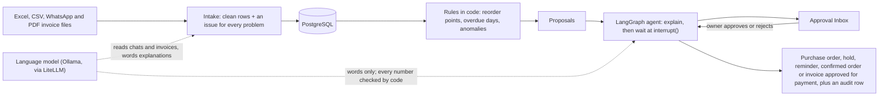

<div align="center">



[🌐 Portfolio](https://shubham-ai-lab.vercel.app/) · [👤 GitHub profile](https://github.com/Shubham261299) · [💼 LinkedIn](https://www.linkedin.com/in/shubham-jamdar-2571271b3)

</div>

# OpsPilot

[](https://github.com/Shubham261299/opspilot/actions/workflows/ci.yml)

An AI back office for a small distributor. OpsPilot turns messy WhatsApp orders, an Excel stock
sheet and PDF supplier invoices into clean data. Agents then propose actions (reorders, payment
reminders, anomaly flags), and the owner approves every action before anything happens.

The customer is fictional: **Sharma Traders**, an electrical and hardware parts distributor in
Pune with 60 products, 25 shop-owner customers and 6 suppliers. Every name, number and record in
this repo is invented.

> **Status:** building in public, week 4 of 7 done (v0.3a); next is tracing and evals. Only
> features marked ✅ work today; the rest is on the [roadmap](#roadmap).

## What works so far

| Feature | Status |
| --- | --- |
| API skeleton: health check, structured JSON logs, Docker Compose | ✅ |
| Database schema with migrations; 6 suppliers and 60 products loaded on start-up | ✅ |
| Stock register cleaner: reports all 11 problems planted in the sample file, with no false alarms (measured by the answer-key test) | ✅ |
| API: upload the stock register → clean stock counts, open PO notes and every issue saved in Postgres in one transaction, plus an audit row | ✅ |
| API: products with current stock (`GET /products`) and issues per upload (`GET /issues`) | ✅ |
| Web app: Upload (drag and drop), Stock (table with search), Issues (grouped by type) | ✅ |
| Customers, outstanding dues and 90-day sales history uploads; the customer and dues cleaners report all 4 problems planted in those files, so 15 of 15 across all files, with no false alarms (answer-key tests) | ✅ |
| Reorder and credit rules from the company policy, as pure functions: 8 of 8 expected reorders with the exact quantities, and 10 of 10 expected payment actions (answer-key tests) | ✅ |
| Approval Inbox: *Run checks* proposes reorders, payment reminders and order holds with the numbers behind them; approving creates the purchase order, the hold or a reminder ready to send, rejecting records why, and every decision is written to the audit log | ✅ |
| Customers page with credit terms, balances and hold status | ✅ |
| WhatsApp orders: a chat export is read by a local language model in the background; products are matched by code first and the model second, and anything doubtful goes to review, never guessed. Each order waits in the Approval Inbox to be confirmed; the owner can fix any line. Measured against the answer key with `scripts/score_parser.py`: qwen2.5:14b gets 15 of 16 orders fully right and 44 of 45 lines exact, with 0 wrong products or quantities (the last line goes to review); qwen2.5:7b gets 14 of 16 and 44 of 45, also 0 wrong, 2× faster | ✅ |
| Approval agents (LangGraph): each proposal pauses at `interrupt()` until the owner decides, saved in Postgres so it survives a restart (an agent cut off while explaining carries on from its checkpoint when the API starts), then the decision is applied and audited | ✅ |
| Explanations written by the language model, with every number checked by code: on the first real run 33 of 34 passed, and the one rejected had invented an amount, so the code's own wording was shown instead | ✅ |
| CI on every pull request and push to `main`: lint, tests against a real Postgres, frontend type-check, lint and build | ✅ |
| Live updates over a WebSocket: new proposals, AI explanations, decisions and finished uploads appear in the Approval Inbox, Orders and Upload pages without a refresh, and the connection comes back by itself after a restart | ✅ |
| Supplier invoice PDFs: drop several at once on the Upload page; the text is read with pypdf, the item table by code, the header and totals by the language model, and code checks every line, the subtotal, GST and the grand total to the paisa. An Invoices page shows each line next to the last purchase rate. On a real run (qwen2.5:14b) all 4 sample invoices were read and every line matched | ✅ |
| Anomaly checks from the company policy, as pure functions: a duplicate invoice is saved as `duplicate` and can never be approved (1 of 1, also when both copies arrive at once); an invoice rate more than 10% above the last purchase rate is flagged (1 of 1: ₹63.36 against ₹48, +32.0%); an order more than 5× the customer's usual quantity is flagged (Royal Hardware's 200 coils, 120×), shown on the order's Inbox card. Honest note: against the counter-sized sample sales history the order rule also flags 27 bulk lines the answer key doesn't list, so confirmed orders become the baseline as they build up ([decision 036](docs/decisions.md)) | ✅ |
| Invoices wait in the Approval Inbox as "approve for payment" proposals, with any price jump marked for the owner; approval is refused while the supplier is unknown, a line has no product or the figures don't add up | ✅ |

## Run it locally

Requires Docker Desktop.

```bash
docker compose up --build
```

Then open **<http://localhost:3000>**:

1. On the **Upload** page, drop the four files from `sample_data/` on their cards, in order:
   `stock_register.xlsx`, `customers.xlsx`, `outstanding_dues.xlsx`, `sales_history_90d.csv`.
2. In the **Approval Inbox**, press **Run checks**, then approve or reject the proposals.
3. Optional, needs a language model: drop `whatsapp_orders_export.txt` on the WhatsApp card. Its
   orders appear in the Inbox a few minutes later, and the proposals get written explanations.
4. Optional, needs a language model: drop the four `invoice_*.pdf` files on the invoice card
   together. Each is read in about a minute; of the two SC-118 PDFs, the one finished second
   (normally the copy) is marked duplicate and never offered for payment, and Brightline's 9W
   bulb is flagged as 32% above its last purchase rate.

The pages update by themselves as background work finishes (the dot at the top right shows
"Live").

The language model runs on your computer with [Ollama](https://ollama.com): `ollama pull
qwen2.5:14b` (or `qwen2.5:7b`, 2.6× faster, set `LLM_MODEL=ollama_chat/qwen2.5:7b`). Without it
everything else works; proposals keep the code's own explanation, and a WhatsApp chat or an
invoice is reported as unread instead of guessed.

The sample data describes 24 Sep 2026, so the API treats that day as "today" (set `APP_TODAY` to
change it). On start the API applies database migrations and loads the reference data. Also
available:

- API docs: <http://localhost:8000/docs>. To try the upload there, open `POST /uploads/stock`,
  click *Try it out* and choose `sample_data/stock_register.xlsx`
- Current stock: <http://localhost:8000/products>
- Issues from the latest upload: <http://localhost:8000/issues>
- Health check: <http://localhost:8000/health>
- Database shell: `docker compose exec db psql -U opspilot` (Postgres is published on host port
  5433, so it doesn't clash with a locally installed Postgres)

## Screenshots

The Approval Inbox: WhatsApp orders and proposals, explained by the language model with every
number checked by code.


Orders read from WhatsApp: what the customer wrote next to the matched product; any line can be
fixed before the order is confirmed.


A supplier invoice read from its PDF: each rate next to the last purchase rate, with the 9W bulb's
32% rise flagged by code.


Invoices waiting to be approved for payment, explained by the language model with every number
checked.


The Upload page: one card per file; invoices can be dropped several at once.


## How it works



Code calculates every quantity, amount and date; the language model only reads messy text and
words explanations, and its text is rejected if it contains a number the code didn't produce.
Nothing is ordered, held, sent, confirmed or paid until the owner approves it.

## Run the tests

```bash
docker compose up -d db          # tests use their own opspilot_test database on this server
cd backend
python -m venv .venv
source .venv/bin/activate        # Windows: .venv\Scripts\activate
pip install -r requirements-dev.txt
pytest                           # unit tests + database tests (a fake model; no LLM needed)
ruff check . && ruff format --check .
cd .. && python scripts/score_parser.py   # WhatsApp parser vs the answer key, with the real model
```

Frontend, with instant reload while you edit (needs the API running on port 8000):

```bash
cd frontend
npm install
npm run dev                      # http://localhost:5173
npm run typecheck && npm run lint && npm run build
```

## Stack

- **Backend:** Python 3.12 · FastAPI · Pydantic v2 · SQLAlchemy 2 (async) · Alembic · pandas ·
  pypdf · PostgreSQL 16
- **Frontend:** React 19 · TypeScript · Vite · Tailwind CSS · shadcn/ui · React Router
- **AI:** LiteLLM (one way to any model) · Ollama with qwen2.5 locally · LangGraph agents with
  a Postgres checkpointer
- **Realtime:** FastAPI WebSockets
- **Running it:** Docker Compose (Postgres, API, nginx serving the web app)
- **CI:** GitHub Actions (backend and frontend jobs in parallel, Postgres as a service container)

More pieces arrive as the features that need them ship.

## Roadmap

| Week | Release | What it adds |
| --- | --- | --- |
| 1 ✅ | v0.1 | Stock register upload, Issues page, CI |
| 2 ✅ | v0.2a | Customers, dues and sales history; reorder and payment rules; Approval Inbox |
| 3 ✅ | v0.2 | LLM agents (LiteLLM, LangGraph) that pause for approval; WhatsApp orders |
| 4 ✅ | v0.3a | PDF supplier invoices, anomaly checks, live inbox (WebSockets) |
| 5 | v0.3 | Tracing (Langfuse) and an eval suite in CI |
| 6 | v0.4 | Policy search (pgvector); proposals cite the rule they follow |
| 7 | v1.0 | Public demo |

## Design decisions

Each real design choice, with the options considered, is recorded in
[docs/decisions.md](docs/decisions.md).
