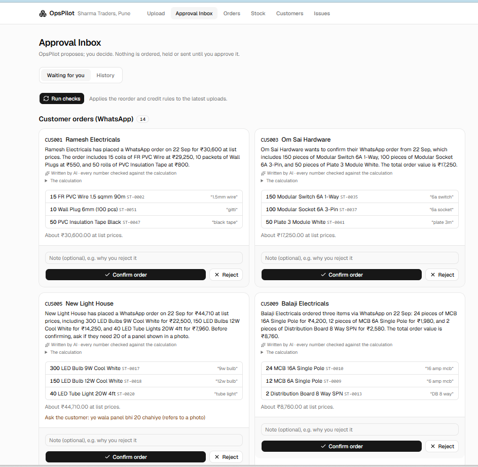
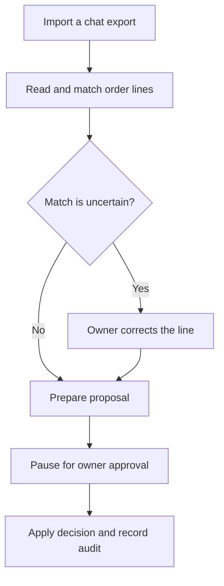
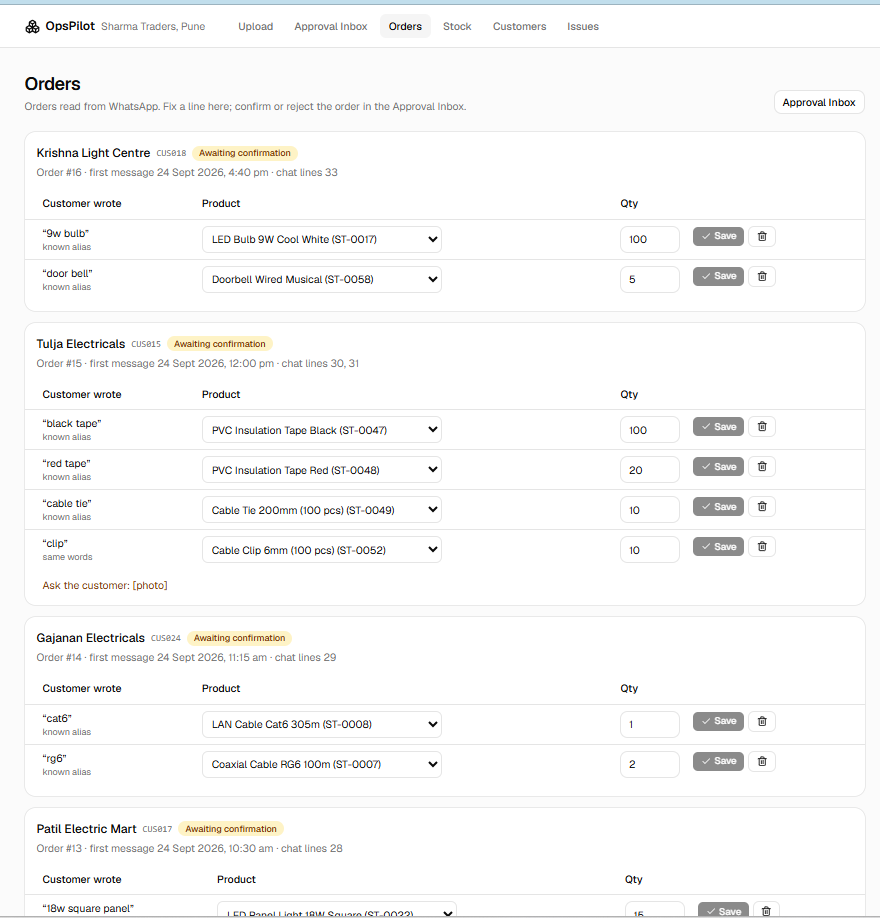
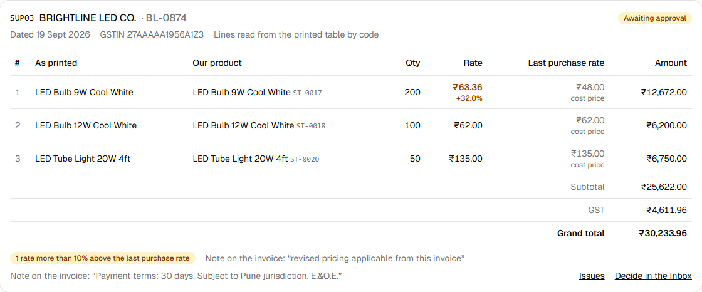
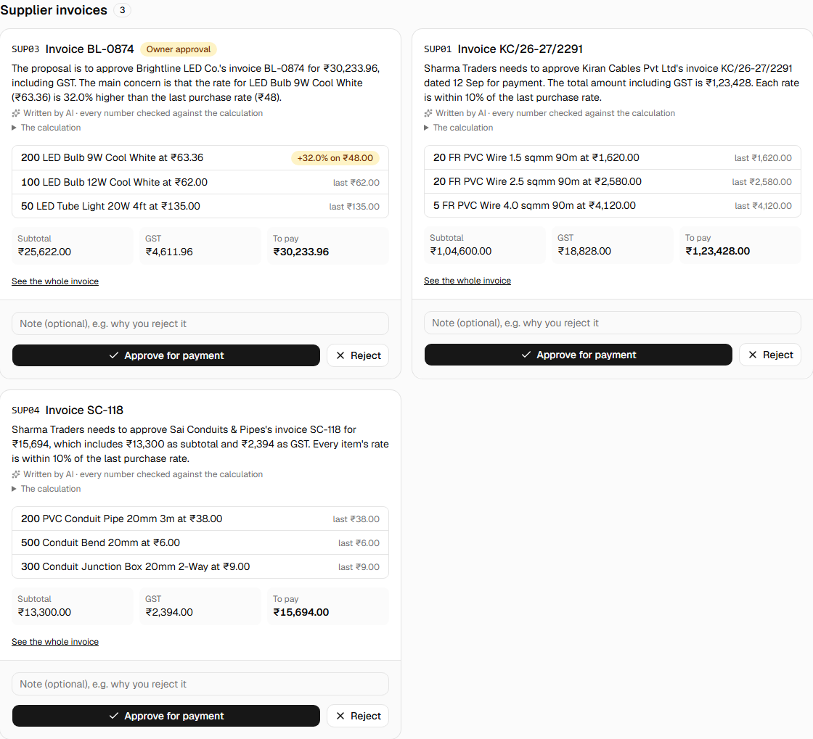
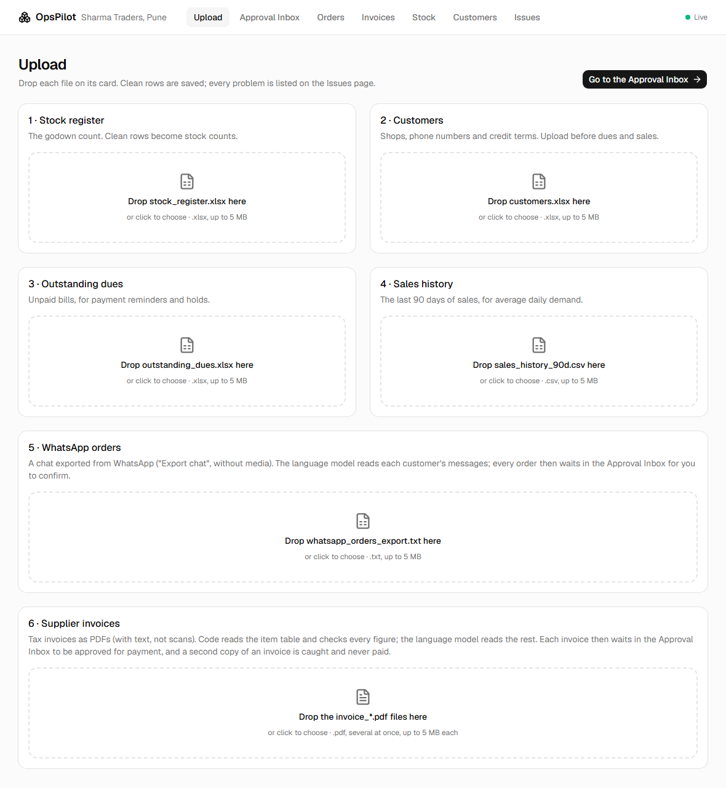
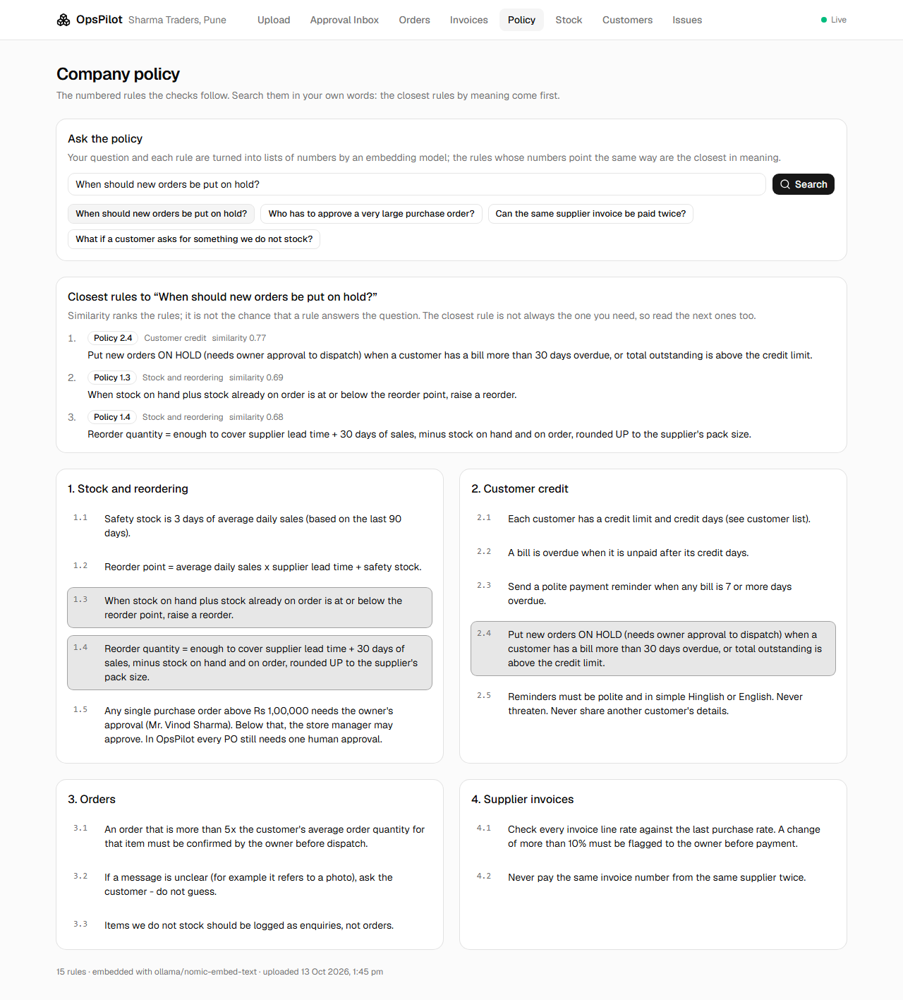
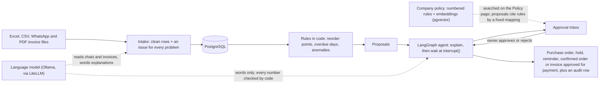

# OpsPilot

### From messy orders to actions you approve.

An AI back office for a small distributor. WhatsApp exports, stock spreadsheets and supplier invoices become clean data and reviewable proposals—with the owner in control.

**[Run it locally →](#run-it-locally)** · [Explore the case study ↗](https://shubham-ai-lab.vercel.app/work/opspilot) · [Architecture](#how-it-works) · [Roadmap](#roadmap)

**Status: v0.4 · Local app.** A hosted public demo is planned, not available yet. The sample business, Sharma Traders in Pune, and every customer, supplier and record are fictional.

[](https://github.com/Shubham261299/opspilot/actions/workflows/ci.yml)

## See the approval workflow



*Actual local-app screenshot. The cover above is an illustration.*

## One order, end to end



Code calculates quantities, amounts and policy decisions. Local models read messy text and explain proposals; doubtful matches go to review. Approval creates the relevant record or a reminder ready to send—it does not automatically send a message or make a payment.

## Engineering receipt

| Choice | What it means here |
| --- | --- |
| Code checks the numbers | Model-written explanations are rejected if they introduce amounts that code did not produce. |
| Approval survives a restart | LangGraph checkpoints in Postgres keep proposals waiting for the owner's decision. |
| Search is not policy authority | Semantic search helps find rules; proposals cite a fixed mapping in code. |
| Show the rough edges | Small sample evaluations and documented anomaly false positives remain visible below. |

## What works today

- Clean stock, customer, dues and sales files; preserve issues and audit records.
- Propose reorders, reminders and holds from deterministic policy rules.
- Read WhatsApp orders and PDF invoices with local models and code validation.
- Review proposals in an approval inbox with live updates.
- Search policy text and inspect the numbered rules supporting a proposal.

<details>
<summary><strong>Detailed feature checklist, measured results and known limitations</strong></summary>

| Feature | Status |
| --- | --- |
| API skeleton: health check, structured JSON logs, Docker Compose | ✅ |
| Database schema with migrations; 6 suppliers and 60 products loaded on start-up | ✅ |
| Stock register cleaner: reports all 11 problems planted in the sample file, with no false alarms (measured by the answer-key test) | ✅ |
| API: upload the stock register → clean stock counts, open PO notes and every issue saved in Postgres in one transaction, plus an audit row | ✅ |
| API: products with current stock (`GET /products`) and issues per upload (`GET /issues`) | ✅ |
| Web app: Upload (drag and drop), Stock (table with search), Issues (grouped by type) | ✅ |
| Customers, outstanding dues and 90-day sales history uploads; the customer and dues cleaners report all 4 problems planted in those files, so 15 of 15 across all files, with no false alarms (answer-key tests) | ✅ |
| Reorder and credit rules from the company policy, as pure functions: 8 of 8 expected reorders with the exact quantities, and 10 of 10 expected payment actions (answer-key tests) | ✅ |
| Approval Inbox: *Run checks* proposes reorders, payment reminders and order holds with the numbers behind them; approving creates the purchase order, the hold or a reminder ready to send, rejecting records why, and every decision is written to the audit log | ✅ |
| Customers page with credit terms, balances and hold status | ✅ |
| WhatsApp orders: a chat export is read by a local language model in the background; products are matched by code first and the model second, and anything doubtful goes to review, never guessed. Each order waits in the Approval Inbox to be confirmed; the owner can fix any line. Measured against the answer key with the eval suite (`python evals/run.py whatsapp`, 13 Oct 2026): qwen2.5:14b gets 15 of 16 orders fully right and 44 of 45 lines exact, with 0 wrong products or quantities (the last line goes to review); qwen2.5:7b gets 13 of 16 and 43 of 45, 2× faster, and picked one wrong product (marked "matched by the model" for the owner to check). One run each; the same model can read an ambiguous line differently between runs | ✅ |
| Approval agents (LangGraph): each proposal pauses at `interrupt()` until the owner decides, saved in Postgres so it survives a restart (an agent cut off while explaining carries on from its checkpoint when the API starts), then the decision is applied and audited | ✅ |
| Explanations written by the language model, with every number checked by code: on the first real run 33 of 34 passed, and the one rejected had invented an amount, so the code's own wording was shown instead | ✅ |
| Policy search: `company_policy.pdf` is split by code into its 15 numbered rules, each embedded with `nomic-embed-text` (Ollama) and stored in Postgres with pgvector. The Policy page and `GET /policy/search` find the rules closest in meaning to a question. On 18 fixed questions (15 English, 3 Hinglish; written before the first run, one run) the right rule is the closest in 10 (56%) and among the closest three in 14 (78%): English 9 and 11 of 15, Hinglish 1 and 3 of 3. Misses are mostly a neighbouring rule (1.3 vs 1.4, 2.2 vs 2.3, 3.3 vs 3.2). So search helps you find a rule but is not trusted to decide one | ✅ |
| Proposals show the policy rules they follow (reorder 1.2 to 1.4, reminder 2.3 and 2.5, hold 2.4, order 2.4/3.1/3.2, invoice 4.1 and 4.2), each with what it did with the rule and the rule's wording. They come from a fixed mapping in code, never from search, and a test fails if a cited rule number is missing from the policy | ✅ |
| CI on every pull request and push to `main`: lint, tests against a real Postgres, the evals replayed from recordings, frontend type-check, lint and build | ✅ |
| Tracing of every model call in Langfuse (optional: set the three `LANGFUSE_*` keys in `.env`; without them nothing is sent and the app behaves the same): prompt, answer, model, tokens, latency, and whether the repair retry was needed. Tracing can't break a call, as a test shows | ✅ |
| Eval suite (`evals/`): the WhatsApp order reading, the invoice reading and the policy search are scored against the answer key. With the real model, qwen2.5:14b reads all 4 sample invoices right (12 of 12 lines, every total to the paisa), and so does 7b. CI replays recorded model answers and embeddings, so it catches broken reading, search or scoring code without needing a model (it can't tell if the model got worse: only a real run can) | ✅ |
| Live updates over a WebSocket: new proposals, AI explanations, decisions and finished uploads appear in the Approval Inbox, Orders and Upload pages without a refresh, and the connection comes back by itself after a restart | ✅ |
| Supplier invoice PDFs: drop several at once on the Upload page; the text is read with pypdf, the item table by code, the header and totals by the language model, and code checks every line, the subtotal, GST and the grand total to the paisa. An Invoices page shows each line next to the last purchase rate. On a real run (qwen2.5:14b) all 4 sample invoices were read and every line matched | ✅ |
| Anomaly checks from the company policy, as pure functions: a duplicate invoice is saved as `duplicate` and can never be approved (1 of 1, also when both copies arrive at once); an invoice rate more than 10% above the last purchase rate is flagged (1 of 1: ₹63.36 against ₹48, +32.0%); an order more than 5× the customer's usual quantity is flagged (Royal Hardware's 200 coils, 120×), shown on the order's Inbox card. Honest note: against the counter-sized sample sales history the order rule also flags 27 bulk lines the answer key doesn't list, so confirmed orders become the baseline as they build up ([decision 036](docs/decisions.md)) | ✅ |
| Invoices wait in the Approval Inbox as "approve for payment" proposals, with any price jump marked for the owner; approval is refused while the supplier is unknown, a line has no product or the figures don't add up | ✅ |


</details>

## Run it locally

Requires Docker Desktop.

```bash
docker compose up --build
```

Then open **<http://localhost:3000>**:

1. On the **Upload** page, drop the four files from `sample_data/` on their cards, in order:
   `stock_register.xlsx`, `customers.xlsx`, `outstanding_dues.xlsx`, `sales_history_90d.csv`.
2. In the **Approval Inbox**, press **Run checks**, then approve or reject the proposals.
3. Optional, needs a language model: drop `whatsapp_orders_export.txt` on the WhatsApp card. Its
   orders appear in the Inbox a few minutes later, and the proposals get written explanations.
4. Optional, needs a language model: drop the four `invoice_*.pdf` files on the invoice card
   together. Each is read in about a minute; of the two SC-118 PDFs, the one finished second
   (normally the copy) is marked duplicate and never offered for payment, and Brightline's 9W
   bulb is flagged as 32% above its last purchase rate.

5. Optional, needs an embedding model: drop `company_policy.pdf` on the policy card, then open
   the **Policy** page and ask a question in your own words. The Inbox cards then show the
   policy rule each proposal follows, with the rule's wording.

The pages update by themselves as background work finishes (the dot at the top right shows
"Live").

The language model runs on your computer with [Ollama](https://ollama.com): `ollama pull
qwen2.5:14b` (or `qwen2.5:7b`, 2.6× faster, set `LLM_MODEL=ollama_chat/qwen2.5:7b`), and `ollama
pull nomic-embed-text` for policy search. Without them everything else works; proposals keep the code's own explanation, and a WhatsApp chat or an
invoice is reported as unread instead of guessed.

The sample data describes 24 Sep 2026, so the API treats that day as "today" (set `APP_TODAY` to
change it). On start the API applies database migrations and loads the reference data. Also
available:

- API docs: <http://localhost:8000/docs>. To try the upload there, open `POST /uploads/stock`,
  click *Try it out* and choose `sample_data/stock_register.xlsx`
- Current stock: <http://localhost:8000/products>
- Issues from the latest upload: <http://localhost:8000/issues>
- Health check: <http://localhost:8000/health>
- Database shell: `docker compose exec db psql -U opspilot` (Postgres is published on host port
  5433, so it doesn't clash with a locally installed Postgres)

## Screenshots

The Approval Inbox: WhatsApp orders and proposals, explained by the language model with every
number checked by code.


Orders read from WhatsApp: what the customer wrote next to the matched product; any line can be
fixed before the order is confirmed.



A supplier invoice read from its PDF: each rate next to the last purchase rate, with the 9W bulb's
32% rise flagged by code.



Invoices waiting to be approved for payment, explained by the language model with every number
checked.



The Upload page: one card per file; invoices can be dropped several at once.



The Policy page: a question in plain words, the closest rules with their similarity (a ranking, not
a probability), and every rule below with the matches highlighted.



## How it works



Code calculates every quantity, amount and date; the language model only reads messy text and
words explanations, and its text is rejected if it contains a number the code didn't produce.
The owner approves before an operation is applied. Approval creates the purchase order, hold, confirmed order, invoice approval or reminder ready to send, plus an audit record; it does not itself send reminders or transfer money.

## Run the tests

```bash
docker compose up -d db          # tests use their own opspilot_test database on this server
cd backend
python -m venv .venv
source .venv/bin/activate        # Windows: .venv\Scripts\activate
pip install -r requirements-dev.txt
pytest                           # unit tests + database tests (a fake model; no LLM needed)
ruff check . && ruff format --check .
python -m pytest ../evals        # the evals, replayed from recorded model answers (no LLM; needs the db above)
cd .. && python evals/run.py all # the evals with the real model (Ollama); see evals/README.md
```

Frontend, with instant reload while you edit (needs the API running on port 8000):

```bash
cd frontend
npm install
npm run dev                      # http://localhost:5173
npm run typecheck && npm run lint && npm run build
```

## Stack

- **Backend:** Python 3.12 · FastAPI · Pydantic v2 · SQLAlchemy 2 (async) · Alembic · pandas ·
  pypdf · PostgreSQL 16 with pgvector
- **Frontend:** React 19 · TypeScript · Vite · Tailwind CSS · shadcn/ui · React Router
- **AI:** LiteLLM (one way to any model) · Ollama with qwen2.5 and nomic-embed-text locally ·
  LangGraph agents with a Postgres checkpointer · Langfuse tracing (optional)
- **Realtime:** FastAPI WebSockets
- **Running it:** Docker Compose (Postgres, API, nginx serving the web app)
- **CI:** GitHub Actions (backend and frontend jobs in parallel, Postgres as a service container)

More pieces arrive as the features that need them ship.

## Roadmap

| Week | Release | What it adds |
| --- | --- | --- |
| 1 ✅ | v0.1 | Stock register upload, Issues page, CI |
| 2 ✅ | v0.2a | Customers, dues and sales history; reorder and payment rules; Approval Inbox |
| 3 ✅ | v0.2 | LLM agents (LiteLLM, LangGraph) that pause for approval; WhatsApp orders |
| 4 ✅ | v0.3a | PDF supplier invoices, anomaly checks, live inbox (WebSockets) |
| 5 ✅ | v0.3 | Tracing (Langfuse) and an eval suite in CI |
| 6 ✅ | v0.4 | Policy search (pgvector); proposals cite the rule they follow |
| 7 | v1.0 | Public demo |

## Design decisions

Each real design choice, with the options considered, is recorded in
[docs/decisions.md](docs/decisions.md).

## License

[MIT](LICENSE).


---

[Explore more of my work →](https://shubham-ai-lab.vercel.app/work) · [GitHub profile](https://github.com/Shubham261299)
